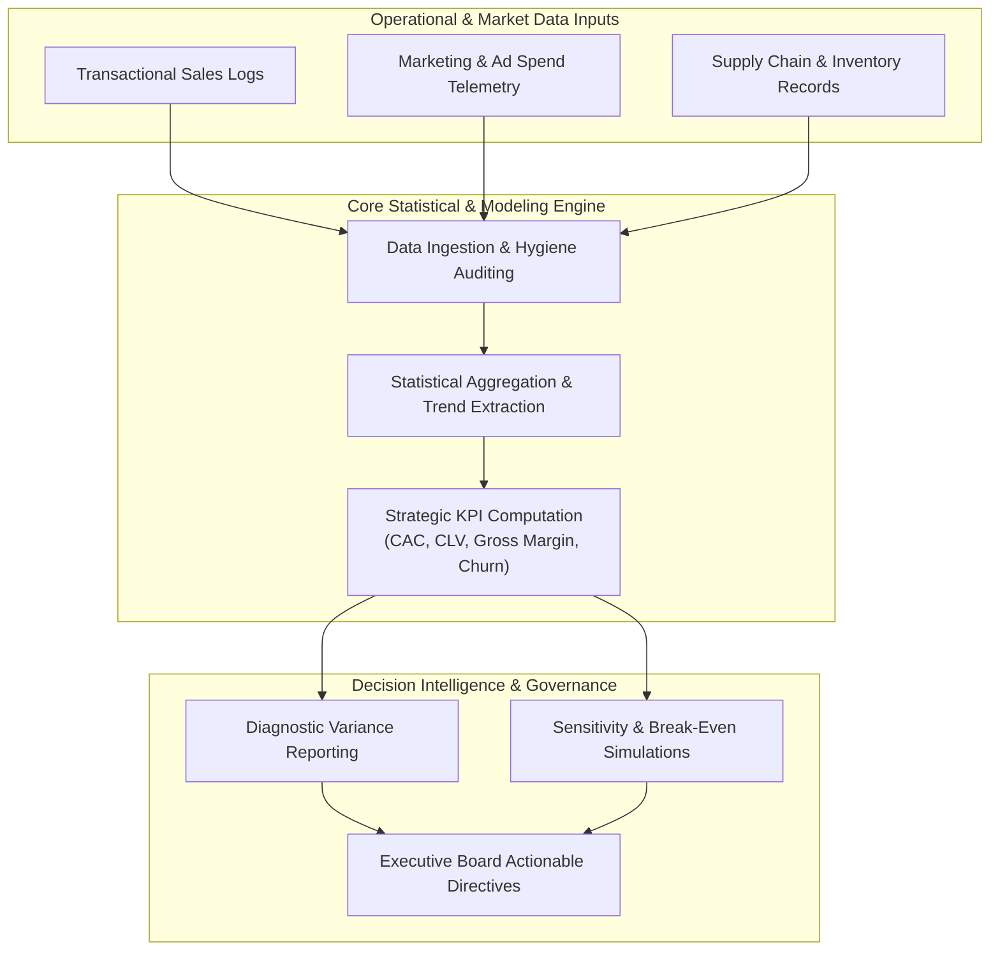

<div align="center">

<a href="https://github.com/akashvenkey/Business-Analytics">

</a>


### 🔗 **Project Source Link:** [https://github.com/akashvenkey/Business-Analytics](https://github.com/akashvenkey/Business-Analytics)

[](https://github.com/akashvenkey/Business-Analytics)
[](https://github.com/akashvenkey/Business-Analytics.git)

[](https://github.com/akashvenkey/Business-Analytics)
[](https://github.com/akashvenkey/Business-Analytics)
[](#)
[-Alliance_University-blue?style=for-the-badge)](https://www.alliance.edu.in/)
[](#)

</div>

---

## 📌 Executive Summary & Overview

In competitive market landscapes, organizational success hinges on transforming raw operational telemetry into rigorous, quantitative decision frameworks. Relying on intuition or retrospective summaries often leads to delayed responses, undetected margin leakage, and inaccurate forecasting.

The **Business Analytics Core** repository establishes an analytical foundation for strategic business intelligence, descriptive and diagnostic statistics, KPI metric architecture, and decision optimization. It synthesizes methodologies across variance analysis, sales pipeline health monitoring, customer lifetime value (CLV) estimation, and operational efficiency auditing. This repository serves as the conceptual and analytical bedrock for higher-level dashboard implementations and predictive data models.

---

## 📑 Interactive Table of Contents

- [📌 Executive Summary & Overview](#-executive-summary--overview)
- [✨ Key Features & Capabilities](#-key-features--capabilities)
- [📊 Strategic KPI Architecture](#-strategic-kpi-architecture)
- [🏗 System Architecture & Decision Flow](#-system-architecture--decision-flow)
- [🛠 Tech Stack Breakdown](#-tech-stack-breakdown)
- [🚀 Reproducible Quickstart & Setup](#-reproducible-quickstart--setup)
- [📂 Project Directory Layout](#-project-directory-layout)
- [👨‍💻 Author & Contributions](#-author--contributions)

---

## ✨ Key Features & Capabilities

- **📐 Quantitative Business Modeling:** Formalization of financial and operational indicators, including Net Present Value (NPV), Customer Acquisition Cost (CAC), Return on Investment (ROI), and churn dynamics.
- **📊 Descriptive & Diagnostic Statistics:** Distributional analysis, interquartile range (IQR) outlier boundaries, variance decomposition, and correlation matrices.
- **🔍 Cohort & Lifecycle Analysis:** Longitudinal tracking of customer retention rates, repeat purchase behaviors, and cohort-level margin contributions over time.
- **🎯 Scenario & Sensitivity Analysis:** Break-even simulations assessing the financial elasticity of price changes, cost inflation, and inventory carrying overheads.
- **📈 Executive Decision Frameworks:** Standardized templates translating analytical findings into C-suite executive summaries and actionable strategic recommendations.

---

## 📊 Strategic KPI Architecture

| Strategic KPI | Formula / Mathematical Definition | Analytical Purpose |
| :--- | :---: | :--- |
| **Gross Margin Ratio** | $\frac{\text{Gross Revenue} - \text{COGS}}{\text{Gross Revenue}} \times 100$ | Evaluates baseline production and procurement efficiency before operational expenses. |
| **Customer Acquisition Cost (CAC)** | $\frac{\text{Total Sales \& Marketing Expenses}}{\text{Number of New Customers Acquired}}$ | Measures customer acquisition efficiency and marketing capital allocation. |
| **Customer Lifetime Value (CLV)** | $\frac{\text{Average Purchase Value} \times \text{Purchase Frequency}}{\text{Churn Rate}}$ | Forecasts long-term gross margin generated across a customer relationship. |
| **Operating Cash Ratio** | $\frac{\text{Operating Cash Flow}}{\text{Current Liabilities}}$ | Gauges immediate liquidity and short-term debt servicing capability. |
| **Inventory Turnover Ratio** | $\frac{\text{Cost of Goods Sold (COGS)}}{\text{Average Inventory Value}}$ | Assesses supply chain liquidity and warehouse shelf velocity. |

---

## 🏗 System Architecture & Decision Flow

The following flowchart outlines the transformation pipeline from raw operational transactions to executive strategic intervention:



---

## 🛠 Tech Stack Breakdown

| Category | Tools & Techniques | Description |
| :--- | :--- | :--- |
| **Modeling Paradigms** | Statistical & Financial Modeling | Cohort analysis, variance decomposition, regression models |
| **Analytical Software** | Microsoft Excel, Power BI, Python | Data manipulation, pivot modeling, formula calculation |
| **Metrics Standard** | GAAP & Corporate KPI Standards | Standardized financial, operational, and customer health metrics |
| **Domain Expertise** | Business Strategy & Intelligence | Retail optimization, unit economics, supply chain analytics |
| **Documentation** | Structured Markdown & Technical Reports | High-clarity executive presentations and methodological proofs |

---

## 🚀 Reproducible Quickstart & Setup

### Prerequisites
- Python 3.9+ or Microsoft Excel / Power BI Desktop
- Standard Git CLI

### Exploration Workflow
```bash
# 1. Clone the repository
git clone https://github.com/akashvenkey/Business-Analytics.git

# 2. Navigate into project directory
cd Business-Analytics

# 3. Explore core analytical templates and documentation
ls -la
```

---

## 📂 Project Directory Layout

```plaintext
Business-Analytics/
├── models/             # Statistical templates, break-even spreadsheets & formulas
├── documentation/      # Methodological guides on KPI metrics and variance analysis
└── README.md           # Strategic overview, KPI formulas & analytical blueprint
```

---

## 👨‍💻 Author & Contributions

**Akash V**  
- **GitHub:** [@akashvenkey](https://github.com/akashvenkey)  
- **Focus:** Business Analytics, Decision Intelligence & Quantitative Modeling  
- **Course:** Bachelor of Computer Applications (Hons), Alliance University, Bangalore  

Contributions regarding innovative financial heuristics, KPI frameworks, and supply chain models are always welcome. If this repository provides value, consider giving it a ⭐!

---

<div align="center">

<a href="https://github.com/akashvenkey/Business-Analytics">

</a>


### 🔗 **Project Source Link:** [https://github.com/akashvenkey/Business-Analytics](https://github.com/akashvenkey/Business-Analytics)

[](https://github.com/akashvenkey/Business-Analytics)
[](https://github.com/akashvenkey/Business-Analytics.git)

</div>